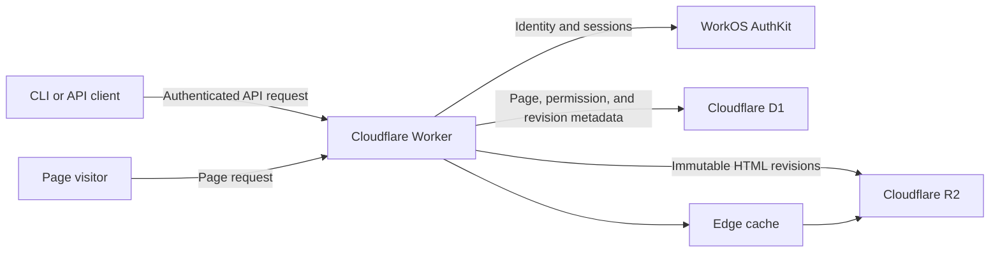

# Postpage Architecture

## Status

This document records the product and architecture decisions for Postpage. It describes the intended product rather than a complete implementation specification.

Revised 2026-07-19, after the MVP shipped to production: per-page subdomains and the resolver URL are dropped in favour of flat URLs, signup is self-serve, and plans with quotas and expiry are defined. Where the deployed implementation still reflects the earlier design, the [issue tracker](https://github.com/lengarvey/postpage/issues) tracks the migration.

## Purpose

Postpage lets coding agents and other API clients publish a self-contained HTML document as an isolated static web page.

The primary use cases are publishing documentation, analysis, reports, and other generated artifacts. A page is a single HTML document, not a directory of assets or a multi-file website.

Core goals:

- Publishing is trivial from an API or CLI.
- Uploaded HTML is stored and served byte-for-byte unchanged.
- Pages cannot read each other or reach the network: the Content Security Policy is the isolation boundary.
- Page access is enforced at the edge.
- Immutable HTML revisions are inexpensive to store and cache.
- The initial product has no management dashboard and injects no controls or JavaScript into pages.

## System overview



The Worker is the only public route to page content. The R2 bucket is private.

## Page identity and URLs

Each page has:

- A server-generated UUIDv4.
- One stable canonical URL.
- One current revision pointer.
- One sharing configuration.

The canonical page URL is:

```text
https://pages.postpage.ai/{uuid}
```

Only exact UUID-shaped paths serve pages; reserved non-UUID routes such as `/auth/session` coexist on the same host, and everything else returns `404`. A page that needs client-side navigation can use URL fragments, which do not reach the server:

```text
https://pages.postpage.ai/{uuid}#/section
```

The same UUID is used in API paths, D1, R2 prefixes, and the canonical URL.

The UUID is stable page identity, not a rotating sharing token — changing permissions never changes the URL. Because the path is now the only thing distinguishing pages, the UUID must remain server-generated and unguessable.

An earlier design gave every page a unique subdomain (`amber-otter-k7.pages.postpage.ai/s/{uuid}`) plus a `/r/{uuid}` resolver. This was dropped (2026-07-19) as operational complexity — wildcard TLS, a name generator, a cookie-handoff dance — that the Content Security Policy below makes unnecessary.

## Page isolation

Uploaded HTML is untrusted and may contain arbitrary inline JavaScript, and all pages now share the `pages.postpage.ai` origin. Isolation therefore rests on two boundaries:

- **The hosted-page CSP** (below) sets `connect-src 'none'` and blocks all subresource loading, so one page's scripts cannot fetch another page — even same-origin — and cannot exfiltrate anything they compute. This policy is load-bearing and must be pinned by tests.
- **The API lives on `api.postpage.ai`**, a different origin. The browser session cookie on `pages.postpage.ai` is never sent to the API, so hosted JavaScript cannot invoke mutating endpoints with a visitor's credentials, and the cookie itself is HTTP-only.

No uploaded HTML is ever served from the `postpage.ai` apex, which hosts the homepage and auth flow.

## Sharing and authorization

A page remains one resource regardless of its sharing mode. The Worker checks its current permissions on every network request and either serves the current HTML revision or denies access.

Supported sharing configuration:

```json
{
  "sharing_mode": "private"
}
```

```json
{
  "sharing_mode": "public"
}
```

```json
{
  "sharing_mode": "specific_users",
  "emails": [
    "alex@example.com",
    "sam@example.com"
  ]
}
```

Semantics:

- `private`: only the owner may view the page.
- `public`: anyone with the complete URL may view the page. Public does not mean listed, indexed, or discoverable.
- `specific_users`: the owner and users with a listed, verified email may view the page.

For `specific_users`, the email array is required and must not be empty. Email permissions are preserved even when no WorkOS user currently has that address. If a user with that verified email is created later, they receive access automatically. No invitation or pending-user workflow is required.

Browser behavior:

- Invalid hostname or UUID: `404 Not Found`.
- Public page: serve without login.
- Private or specific-user page without a session: redirect through WorkOS login, then return to the page.
- Authorized user: serve the current HTML revision.
- Authenticated but unauthorized user: return a simple Postpage `403 Access denied` response.

## Plans, quotas, and expiry

Publishing limits and page lifetime are the product's rate limiting; no separate API-call rate limits are planned. The 10 MiB upload cap applies everywhere.

| Plan | Pages per day | Sharing modes | Page lifetime |
| --- | --- | --- | --- |
| Anonymous | 5 | link-access, locked to first browser | deleted 1 week after publish |
| Free (signed in) | 30 | private, public | deleted after 3 months without a visit |
| Paid *(future)* | 100 | private, public, specific_users | never expires |

Until the paid tier ships, `specific_users` is not plan-gated in the
implementation: any signed-in user can set it.

Free-tier expiry is activity-based, not fixed: any visit refreshes the clock, so only genuinely abandoned pages die and a shared link keeps working as long as anyone uses it. A visit is any authorized read of the page content — a browser page view or an API `GET` of the HTML both count. Tracking this costs almost nothing — the serving path already reads the page row, so the Worker updates `last_visited_at` (day granularity) only when the stored value is more than a day stale, via `waitUntil` so the response never waits on the write. Worst case is one UPDATE per page per day. So that agents and scripts can see the clock, page JSON responses include a computed `expires_at` (`null` on plans without expiry).

Enforcement mechanics (decided 2026-07-19):

- **Quota accounting** uses a usage counter table keyed by owner and UTC calendar day, incremented atomically with page creation. Deleting a page never refunds quota, which closes the create-and-delete loop. The window is the UTC day, not a rolling 24 hours — this is abuse control, not billing. An exhausted quota returns `429` with problem code `quota_exceeded`.
- **Updates are not limited** for now. Each `PUT` retains a revision object, so unlimited updates are technically unbounded storage; this is an accepted risk to revisit if it shows up in practice rather than a designed-for case.
- **Plan membership** is a `plan` column on the users table, defaulting to `free`. Launching a paid tier is a value change, not a migration.
- **The expiry sweep and background deletion** run in a daily Cloudflare cron trigger (a `scheduled` handler in the same Worker). Each run selects free-tier pages unvisited for 3 months and deletes them in bounded batches through the standard two-phase deletion (mark in D1, then purge R2), which is idempotent: a crash leaves only marked-but-unpurged objects the next run sweeps. The DELETE endpoint's R2 purge moves onto the same machinery.

The paid plan also carries MCP access when the MCP server exists.

### Anonymous publishing (semantics decided 2026-07-19)

The point of anonymous publishing is the core product loop with zero setup: an agent publishes a page and hands its operator a URL that opens in a browser immediately. That requirement fixes the design — the URL must be sufficient to view, because an anonymous visitor has no session to check and a browser cannot present a bearer token.

- An unauthenticated `POST /v1/pages` succeeds by minting a **guest account**: the response carries the created page plus a guest bearer token (stored hashed). The token is the guest's only credential; there is no recovery if it is lost.
- Viewing is **link-access, locked to the first browser**. The first browser to open the page receives a host-only, HTTP-only viewer cookie (a random viewer id) and the page binds to it; every later browser view requires that cookie. The same viewer cookie serves for all of a browser's guest pages — binding is a per-page row, not a per-page cookie. Guests cannot change sharing.
- Any other browser — a second person the link leaked to, or the operator on another device or after clearing cookies — receives a lockout response instead of the page. The lockout is **deliberate friction and a conversion surface**: it explains that the page is locked to the browser that first opened it and invites the visitor to sign up. (Converting a guest's pages into a signed-in account is where a claim flow will eventually live; until then the pitch is to sign up and republish.)
- The design assumes the direct handoff workflow: the agent gives the URL straight to its operator, who opens it. It does not defend the first-view race against link scanners or chat previews, because in this workflow the link never transits those systems.
- The binding is irrevocable: there is no reset. A viewer who loses the cookie (new device, cleared cookies) has lost browser access to that page — sign up and republish, or read it through the API. Given the 1-week lifetime, permanence is acceptable and the dead end is itself the upsell.
- The guest account owns its pages: API requests bearing the guest token manage them normally (update, pull, list, delete) and bypass the viewer lock entirely — the lock gates only the browser serving path.
- Because minting a fresh guest account is free, the 5 pages/day quota is enforced per client IP — the same usage counter table, keyed by IP and UTC day.
- The 1-week lifetime is fixed from publish (not activity-based) and rides the same daily cron sweep; guest accounts whose pages have all expired are swept with them.
- There is no claim-into-account flow for now: keeping a page past the anonymous tier means republishing it while signed in.

WorkOS AuthKit owns user authentication. Signup is instant and self-serve through AuthKit's hosted UI — Postpage itself has no signup route; AuthKit is the signup surface, and the CLI device-flow login doubles as signup for a brand-new user. Supported methods are Magic Auth (emailed one-time code) and GitHub OAuth; password authentication is disabled. Both methods yield a verified email, which `specific_users` sharing depends on.

The application integration should follow the official WorkOS AuthKit installer:

- <https://workos.com/docs/authkit/cli-installer>

The Postpage CLI login should follow WorkOS CLI Auth's OAuth 2.0 Device Authorization flow:

- <https://workos.com/docs/authkit/cli-auth>

At a high level, `postpage login` requests device authorization, displays or opens the WorkOS verification URL, polls at WorkOS's specified interval, and receives credentials after the user confirms the request.

All API operations require an authenticated bearer credential associated with a WorkOS user. Initial credentials have the full authority of their owner; fine-grained scopes are deferred. The exact WorkOS-supported credential form and lifecycle should be selected during integration rather than implemented as a parallel authentication system in Postpage.

### Browser sessions

When a protected page needs authentication, the browser is redirected through the trusted AuthKit flow, which establishes a secure, HTTP-only, host-only session cookie on `pages.postpage.ai`. One login covers every page the visitor is authorized for.

Uploaded JavaScript cannot read the session cookie (HTTP-only) and cannot ride it anywhere useful: the CSP blocks all outbound requests from hosted pages, and the API is a separate origin. (The earlier per-subdomain design needed a one-time-code handoff to move the session onto each page host; with a single serving host that machinery disappears.)

## API

The examples below omit the API hostname. All requests are authenticated unless stated otherwise.

### Create a page

```http
POST /v1/pages
Authorization: Bearer ...
Content-Type: text/html; charset=utf-8

<!doctype html>
<html>...</html>
```

The body is raw HTML. There is no JSON wrapper or multipart form. A new page defaults to `private`.

### List pages

```http
GET /v1/pages
GET /v1/pages?collection=owned
GET /v1/pages?collection=shared_with_me
GET /v1/pages?collection=all
```

`GET /v1/pages` is equivalent to `collection=owned`. Public pages are not included merely because they are public.

Lists are ordered by most recently updated and use opaque cursor pagination:

- Default limit: 50.
- Maximum limit: 100.
- The response includes `next_cursor`, or `null` when complete.

### Retrieve a page

The API uses standard HTTP content negotiation:

```http
GET /v1/pages/{uuid}
Accept: text/html
```

Returns the current raw HTML bytes.

```http
GET /v1/pages/{uuid}
Accept: application/json
```

Returns the HTML together with page information such as UUID, current revision, sharing configuration, URLs, and timestamps.

Missing `Accept` or `Accept: */*` defaults to `text/html`. Unsupported response types return `406 Not Acceptable`. Responses vary by `Accept`.

### Update page content

```http
PUT /v1/pages/{uuid}
Authorization: Bearer ...
Content-Type: text/html; charset=utf-8

<!doctype html>
<html>...</html>
```

Every successful `PUT` creates a new revision, even when its bytes are identical to the previous revision.

### Replace sharing configuration

```http
PUT /v1/pages/{uuid}/sharing
Authorization: Bearer ...
Content-Type: application/json

{
  "sharing_mode": "specific_users",
  "emails": ["alex@example.com"]
}
```

This replaces the complete sharing configuration. It does not change page identity or URLs.

### Delete a page

```http
DELETE /v1/pages/{uuid}
Authorization: Bearer ...
```

Deletion is irreversible. The page becomes inaccessible immediately. All HTML revisions and permissions are permanently removed. A minimal tombstone retains the UUID, owner identifier, and deletion timestamp so the UUID is never reused.

### Errors

API errors use `application/problem+json` and include a stable machine-readable `code`:

```json
{
  "type": "https://postpage.ai/problems/page-too-large",
  "title": "Page exceeds the upload limit",
  "status": 413,
  "detail": "The maximum page size is 10485760 bytes.",
  "code": "page_too_large"
}
```

## CLI

The first-party CLI is the initial human and coding-agent interface over the HTTP API.

```text
postpage login
postpage token
postpage whoami
postpage logout

postpage publish [file]
postpage update <uuid> [file]
postpage pull <uuid> --output <file>

postpage list
postpage list --collection shared_with_me
postpage list --collection all

postpage sharing <uuid> private
postpage sharing <uuid> public
postpage sharing <uuid> specific_users --email <address> [--email <address> ...]

postpage delete <uuid>
```

`publish` and `update` accept either a file path or piped HTML:

```sh
postpage publish page.html
generate-page | postpage publish
generate-page | postpage update {uuid}
postpage publish -
```

If neither a file nor piped content is present, the CLI prints usage instead of waiting unexpectedly. Supplying both is an error.

Commands support `--json` for reliable agent and script integration. Publishing defaults to private.

## MCP server

A remote MCP server (added 2026-07-24; see [MCP.md](MCP.md) for the full design) lets hosted assistants such as Claude and ChatGPT publish pages directly through their connector features.

- **Transport**: stateless Streamable HTTP at `POST /mcp` on the API origin — one JSON response per request, no sessions or SSE.
- **Authorization**: standard MCP OAuth. Postpage is only the protected resource; `/.well-known/oauth-protected-resource` points clients at WorkOS AuthKit, which handles Dynamic Client Registration and the consent flow. Verification is shared with the API (`identityFromAccessToken`) and routes on an issuer allowlist — `https://api.workos.com` tokens verify against the per-client SSO JWKS, AuthKit-domain tokens against `{domain}/oauth2/jwks`; any other issuer is rejected, and the `/mcp` gate additionally enforces RFC 8707 audience binding on tokens that carry an `aud`. There is no parallel credential system.
- **Tools** are a thin adapter dispatching in-process to the pages API, so quotas, validation, and sharing semantics are shared: `publish_page`, `update_page`, `get_page`, `list_pages`, `set_page_sharing`, `delete_page`.

MCP requires a **signed-in account**: guest tokens (minted by anonymous publishing) are rejected at the `/mcp` auth gate with the OAuth challenge, since accepting them would make the MCP server effectively anonymous. MCP access was originally earmarked for the paid plan; until that plan exists the endpoint is open to every signed-in identity, and the future gate is the same single check at the `/mcp` auth step.

## Storage

### R2

HTML is stored in a private Cloudflare R2 bucket. Only trusted Workers may read or write it.

Object keys use the stable UUID and an incrementing, zero-padded revision:

```text
pages/{uuid}/00000001.html
pages/{uuid}/00000002.html
pages/{uuid}/00000003.html
```

Objects are immutable. Every successful update writes a new object. All revisions are retained while the page exists. Revision numbers are reserved before upload, so failed or concurrent updates may leave harmless gaps.

### D1

Cloudflare D1 stores relational metadata only. It does not store page HTML.

The logical data includes:

- Page UUID, owner, current revision, sharing mode, and timestamps (including last visit, at day granularity, for expiry).
- Revision number, R2 key, size, and creation time.
- Email permissions for specific-user sharing.
- User-to-WorkOS identity mapping where required.
- Deletion tombstones.

Exact table definitions, indexes, and migration tooling are implementation details. Page UUIDs must be unique.

## Revision and update behavior

The Worker reserves the next revision number atomically in D1 before uploading the HTML object to R2.

If the R2 upload fails:

- The current revision remains unchanged.
- The reserved number may remain unused.
- The API returns an error.

After a successful R2 upload, D1 is updated to point to the new revision. Concurrent updates must never reuse a revision number or allow an older completed upload to replace a newer activated revision.

Revision history and rollback are intentionally not exposed in the MVP, even though old objects are retained.

## Edge serving and caching

Every page request reaches the Worker. Authorization decisions must never be bypassed by a cached full-page response.

Request flow:

1. Validate the exact `/{uuid}` path on the serving host.
2. Load the page's current metadata and sharing configuration from D1.
3. Authenticate and authorize the requester when required.
4. Resolve the current revision.
5. Fetch immutable HTML from an edge cache or R2 using page UUID plus revision as the cache key.
6. Apply current security and sharing headers.
7. Return the HTML.

The immutable HTML bytes are cacheable; the authorization result is not. A sharing change therefore takes effect on the next request without purging the cached HTML. A content update naturally uses a new cache key because its revision changes.

## Hosted-page isolation policy

Postpage serves the uploaded bytes unchanged but applies browser security headers at response time.

### Network isolation

Hosted pages are intended to be self-contained. The Content Security Policy allows inline HTML, CSS, JavaScript, SVG, and embedded `data:` or runtime-generated `blob:` resources, while blocking external subresources and outbound application connections.

The policy must block at least:

- External scripts, stylesheets, images, fonts, and media.
- `fetch`, XMLHttpRequest, WebSockets, EventSource, and beacons.
- External frames and objects.
- Form submissions.
- External workers.

Ordinary links may still navigate the visitor to another site. Because uploaded HTML runs as a top-level document, Postpage does not claim to provide a fully hermetic execution sandbox.

An illustrative policy is:

```text
default-src 'none';
script-src 'unsafe-inline' 'unsafe-eval' blob:;
style-src 'unsafe-inline';
img-src data: blob:;
font-src data: blob:;
media-src data: blob:;
worker-src blob:;
connect-src 'none';
frame-src 'none';
object-src 'none';
manifest-src 'none';
base-uri 'none';
form-action 'none'
```

The final policy should be verified across supported browsers during implementation.

### Other response policies

All hosted pages receive:

```http
Referrer-Policy: no-referrer
X-Robots-Tag: noindex, noarchive, nosnippet
```

They also receive a restrictive `Permissions-Policy` disabling capabilities unnecessary for documentation and analysis, including camera, microphone, location, payment, USB, Bluetooth, MIDI, and screen capture.

Embedding depends on current sharing mode:

- Public pages may be embedded by other sites.
- Private and specific-user pages include `frame-ancestors 'none'` and must be opened directly.

The Worker constructs these headers after reading current permissions. Headers are not stored with the R2 object.

## Upload constraints

- Request content type: `text/html; charset=utf-8`.
- Maximum body size: 10 MiB (10,485,760 bytes).
- Empty bodies are rejected.
- Accepted bytes are stored unchanged.
- Postpage does not sanitize, format, minify, or rewrite HTML.
- Inline JavaScript and CSS are allowed.
- External references do not need to be detected during upload because the runtime Content Security Policy is the enforcement boundary.

Uploads exceeding the limit return `413 Payload Too Large` using the standard problem response.

## Deletion

Deleting a page has two phases:

1. Mark it unavailable in D1 so all page and API reads fail immediately.
2. Remove every R2 revision and all sharing permissions, retaining only the minimal tombstone.

The mechanics of asynchronous cleanup are an implementation detail, but deleted HTML must not be retained indefinitely.

## Initial non-goals

The product intentionally excludes:

- A management dashboard.
- Injected page controls or scripts.
- Search, directories, or discoverable publishing.
- Search-engine indexing.
- Multiple files or separately hosted assets per page.
- External API access from hosted pages.
- Revision browsing and rollback APIs.
- Page renaming.
- Custom domains.
- Analytics.
- Email invitations.

## Deferred implementation decisions

The following should be decided during implementation without changing the product contract above:

- Worker framework and project layout.
- Exact D1 schema, indexes, and migrations.
- Exact WorkOS credential representation and refresh lifecycle.
- API response field names not explicitly fixed above.
- Cursor encoding.
- CLI packaging and local credential storage.
- Logging, metrics, alerts, and audit retention.
- Test and deployment environments.
