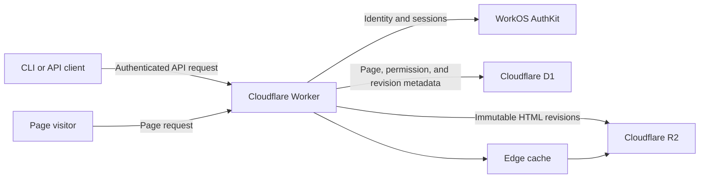

# Postpage Architecture

## Status

This document records the initial product and architecture decisions for Postpage. It describes the intended MVP rather than a complete implementation specification.

The `postpage.ai` domain is a working assumption and may change.

## Purpose

Postpage lets coding agents and other API clients publish a self-contained HTML document as an isolated static web page.

The primary use cases are publishing documentation, analysis, reports, and other generated artifacts. A page is a single HTML document, not a directory of assets or a multi-file website.

Core goals:

- Publishing is trivial from an API or CLI.
- Uploaded HTML is stored and served byte-for-byte unchanged.
- Every page is isolated from every other page by the browser's same-origin policy.
- Page access is enforced at the edge.
- Immutable HTML revisions are inexpensive to store and cache.
- The initial product has no management dashboard and injects no controls or JavaScript into pages.

## System overview



The Worker is the only public route to page content. The R2 bucket is private.

## Page identity and URLs

Each page has:

- A server-generated UUIDv4.
- A server-generated, human-friendly hostname such as `amber-otter-k7`.
- One stable canonical URL.
- One current revision pointer.
- One sharing configuration.

The friendly hostname is generated once, is globally unique, cannot be selected or renamed by the user in the MVP, and is never reused.

The canonical page URL is:

```text
https://amber-otter-k7.pages.postpage.ai/s/{uuid}
```

Only the exact `/s/{uuid}` path serves the page. The hostname without that path and all other paths return `404`. A page that needs client-side navigation can use URL fragments, which do not reach the server:

```text
https://amber-otter-k7.pages.postpage.ai/s/{uuid}#/section
```

The same UUID is used in API paths, D1, R2 prefixes, the canonical URL, and the redirect resolver.

### Resolver URL

The convenient sharing URL is:

```text
https://pages.postpage.ai/r/{uuid}
```

It returns a temporary HTTP redirect to the canonical page URL. The resolver must only redirect to a hostname read from Postpage's own page record. It must never accept an arbitrary destination and must never proxy or render uploaded HTML.

The UUID is stable page identity, not a rotating sharing token. Changing permissions does not change either URL.

## Origin isolation

Uploaded HTML is untrusted and may contain arbitrary inline JavaScript. Browser origins do not include URL paths, so hosting all pages under `pages.postpage.ai/{uuid}` would allow one page to read another page when a visitor is authorized for both.

Each page therefore receives a unique subdomain:

```text
amber-otter-k7.pages.postpage.ai
quiet-orbit-m3.pages.postpage.ai
```

This makes each page a separate browser origin. One page may embed another, but it cannot read the embedded page's DOM or network response.

No uploaded HTML is ever served from `pages.postpage.ai` itself. That origin contains only trusted Postpage routes such as `/r/{uuid}`.

## Sharing and authorization

A page remains one resource regardless of its sharing mode. The Worker checks its current permissions on every network request and either serves the current HTML revision or denies access.

Supported sharing configuration:

```json
{
  "sharing_mode": "private"
}
```

```json
{
  "sharing_mode": "public"
}
```

```json
{
  "sharing_mode": "specific_users",
  "emails": [
    "alex@example.com",
    "sam@example.com"
  ]
}
```

Semantics:

- `private`: only the owner may view the page.
- `public`: anyone with the complete URL may view the page. Public does not mean listed, indexed, or discoverable.
- `specific_users`: the owner and users with a listed, verified email may view the page.

For `specific_users`, the email array is required and must not be empty. Email permissions are preserved even when no WorkOS user currently has that address. If a user with that verified email is created later, they receive access automatically. No invitation or pending-user workflow is required.

Browser behavior:

- Invalid hostname or UUID: `404 Not Found`.
- Public page: serve without login.
- Private or specific-user page without a session: redirect through WorkOS login, then return to the page.
- Authorized user: serve the current HTML revision.
- Authenticated but unauthorized user: return a simple Postpage `403 Access denied` response.

## Authentication

WorkOS AuthKit owns user authentication. There is no public signup route in the MVP; users are created manually through WorkOS.

The application integration should follow the official WorkOS AuthKit installer:

- <https://workos.com/docs/authkit/cli-installer>

The Postpage CLI login should follow WorkOS CLI Auth's OAuth 2.0 Device Authorization flow:

- <https://workos.com/docs/authkit/cli-auth>

At a high level, `postpage login` requests device authorization, displays or opens the WorkOS verification URL, polls at WorkOS's specified interval, and receives credentials after the user confirms the request.

All API operations require an authenticated bearer credential associated with a WorkOS user. Initial credentials have the full authority of their owner; fine-grained scopes are deferred. The exact WorkOS-supported credential form and lifecycle should be selected during integration rather than implemented as a parallel authentication system in Postpage.

### Page-host sessions

Authentication cookies must not be shared across all page subdomains.

When a protected page needs authentication, the browser is redirected through the trusted AuthKit origin. After authentication, the destination page host receives a short-lived assertion or one-time code and establishes a secure, HTTP-only, host-only session for that exact page hostname.

A credential for `amber-otter-k7.pages.postpage.ai` must never be sent to `quiet-orbit-m3.pages.postpage.ai`. Uploaded JavaScript cannot read the page-host session cookie.

## API

The examples below omit the API hostname. All requests are authenticated unless stated otherwise.

### Create a page

```http
POST /v1/pages
Authorization: Bearer ...
Content-Type: text/html; charset=utf-8

<!doctype html>
<html>...</html>
```

The body is raw HTML. There is no JSON wrapper or multipart form. A new page defaults to `private`.

### List pages

```http
GET /v1/pages
GET /v1/pages?collection=owned
GET /v1/pages?collection=shared_with_me
GET /v1/pages?collection=all
```

`GET /v1/pages` is equivalent to `collection=owned`. Public pages are not included merely because they are public.

Lists are ordered by most recently updated and use opaque cursor pagination:

- Default limit: 50.
- Maximum limit: 100.
- The response includes `next_cursor`, or `null` when complete.

### Retrieve a page

The API uses standard HTTP content negotiation:

```http
GET /v1/pages/{uuid}
Accept: text/html
```

Returns the current raw HTML bytes.

```http
GET /v1/pages/{uuid}
Accept: application/json
```

Returns the HTML together with page information such as UUID, friendly hostname, current revision, sharing configuration, URLs, and timestamps.

Missing `Accept` or `Accept: */*` defaults to `text/html`. Unsupported response types return `406 Not Acceptable`. Responses vary by `Accept`.

### Update page content

```http
PUT /v1/pages/{uuid}
Authorization: Bearer ...
Content-Type: text/html; charset=utf-8

<!doctype html>
<html>...</html>
```

Every successful `PUT` creates a new revision, even when its bytes are identical to the previous revision.

### Replace sharing configuration

```http
PUT /v1/pages/{uuid}/sharing
Authorization: Bearer ...
Content-Type: application/json

{
  "sharing_mode": "specific_users",
  "emails": ["alex@example.com"]
}
```

This replaces the complete sharing configuration. It does not change page identity or URLs.

### Delete a page

```http
DELETE /v1/pages/{uuid}
Authorization: Bearer ...
```

Deletion is irreversible. The page becomes inaccessible immediately. All HTML revisions and permissions are permanently removed. A minimal tombstone retains the UUID, friendly hostname, owner identifier, and deletion timestamp so the hostname is never reassigned.

### Errors

API errors use `application/problem+json` and include a stable machine-readable `code`:

```json
{
  "type": "https://postpage.ai/problems/page-too-large",
  "title": "Page exceeds the upload limit",
  "status": 413,
  "detail": "The maximum page size is 10485760 bytes.",
  "code": "page_too_large"
}
```

## CLI

The first-party CLI is the initial human and coding-agent interface over the HTTP API.

```text
postpage login
postpage logout

postpage publish [file]
postpage update <uuid> [file]
postpage pull <uuid> --output <file>

postpage list
postpage list --collection shared_with_me
postpage list --collection all

postpage sharing <uuid> private
postpage sharing <uuid> public
postpage sharing <uuid> specific_users --email <address> [--email <address> ...]

postpage delete <uuid>
```

`publish` and `update` accept either a file path or piped HTML:

```sh
postpage publish page.html
generate-page | postpage publish
generate-page | postpage update {uuid}
postpage publish -
```

If neither a file nor piped content is present, the CLI prints usage instead of waiting unexpectedly. Supplying both is an error.

Commands support `--json` for reliable agent and script integration. Publishing defaults to private.

## Storage

### R2

HTML is stored in a private Cloudflare R2 bucket. Only trusted Workers may read or write it.

Object keys use the stable UUID and an incrementing, zero-padded revision:

```text
pages/{uuid}/00000001.html
pages/{uuid}/00000002.html
pages/{uuid}/00000003.html
```

Objects are immutable. Every successful update writes a new object. All revisions are retained while the page exists. Revision numbers are reserved before upload, so failed or concurrent updates may leave harmless gaps.

### D1

Cloudflare D1 stores relational metadata only. It does not store page HTML.

The logical data includes:

- Page UUID, friendly hostname, owner, current revision, sharing mode, and timestamps.
- Revision number, R2 key, size, and creation time.
- Email permissions for specific-user sharing.
- User-to-WorkOS identity mapping where required.
- Deletion tombstones.

Exact table definitions, indexes, and migration tooling are implementation details. Page UUIDs and friendly hostnames must be unique.

## Revision and update behavior

The Worker reserves the next revision number atomically in D1 before uploading the HTML object to R2.

If the R2 upload fails:

- The current revision remains unchanged.
- The reserved number may remain unused.
- The API returns an error.

After a successful R2 upload, D1 is updated to point to the new revision. Concurrent updates must never reuse a revision number or allow an older completed upload to replace a newer activated revision.

Revision history and rollback are intentionally not exposed in the MVP, even though old objects are retained.

## Edge serving and caching

Every page request reaches the Worker. Authorization decisions must never be bypassed by a cached full-page response.

Request flow:

1. Parse and validate the friendly hostname and exact `/s/{uuid}` path.
2. Load the page's current metadata and sharing configuration from D1.
3. Authenticate and authorize the requester when required.
4. Resolve the current revision.
5. Fetch immutable HTML from an edge cache or R2 using page UUID plus revision as the cache key.
6. Apply current security and sharing headers.
7. Return the HTML.

The immutable HTML bytes are cacheable; the authorization result is not. A sharing change therefore takes effect on the next request without purging the cached HTML. A content update naturally uses a new cache key because its revision changes.

## Hosted-page isolation policy

Postpage serves the uploaded bytes unchanged but applies browser security headers at response time.

### Network isolation

Hosted pages are intended to be self-contained. The Content Security Policy allows inline HTML, CSS, JavaScript, SVG, and embedded `data:` or runtime-generated `blob:` resources, while blocking external subresources and outbound application connections.

The policy must block at least:

- External scripts, stylesheets, images, fonts, and media.
- `fetch`, XMLHttpRequest, WebSockets, EventSource, and beacons.
- External frames and objects.
- Form submissions.
- External workers.

Ordinary links may still navigate the visitor to another site. Because uploaded HTML runs as a top-level document, Postpage does not claim to provide a fully hermetic execution sandbox.

An illustrative policy is:

```text
default-src 'none';
script-src 'unsafe-inline' 'unsafe-eval' blob:;
style-src 'unsafe-inline';
img-src data: blob:;
font-src data: blob:;
media-src data: blob:;
worker-src blob:;
connect-src 'none';
frame-src 'none';
object-src 'none';
manifest-src 'none';
base-uri 'none';
form-action 'none'
```

The final policy should be verified across supported browsers during implementation.

### Other response policies

All hosted pages receive:

```http
Referrer-Policy: no-referrer
X-Robots-Tag: noindex, noarchive, nosnippet
```

They also receive a restrictive `Permissions-Policy` disabling capabilities unnecessary for documentation and analysis, including camera, microphone, location, payment, USB, Bluetooth, MIDI, and screen capture.

Embedding depends on current sharing mode:

- Public pages may be embedded by other sites.
- Private and specific-user pages include `frame-ancestors 'none'` and must be opened directly.

The Worker constructs these headers after reading current permissions. Headers are not stored with the R2 object.

## Upload constraints

- Request content type: `text/html; charset=utf-8`.
- Maximum body size: 10 MiB (10,485,760 bytes).
- Empty bodies are rejected.
- Accepted bytes are stored unchanged.
- Postpage does not sanitize, format, minify, or rewrite HTML.
- Inline JavaScript and CSS are allowed.
- External references do not need to be detected during upload because the runtime Content Security Policy is the enforcement boundary.

Uploads exceeding the limit return `413 Payload Too Large` using the standard problem response.

## Deletion

Deleting a page has two phases:

1. Mark it unavailable in D1 so all page and API reads fail immediately.
2. Remove every R2 revision and all sharing permissions, retaining only the minimal tombstone.

The mechanics of asynchronous cleanup are an implementation detail, but deleted HTML must not be retained indefinitely.

## Initial non-goals

The MVP intentionally excludes:

- A management dashboard.
- Injected page controls or scripts.
- Public signup.
- Search, directories, or discoverable publishing.
- Search-engine indexing.
- Multiple files or separately hosted assets per page.
- External API access from hosted pages.
- Revision browsing and rollback APIs.
- Page renaming.
- Custom domains.
- Analytics.
- Email invitations.
- An MCP server. The MCP server can be added later as a thin adapter over the HTTP API.

## Deferred implementation decisions

The following should be decided during implementation without changing the product contract above:

- Worker framework and project layout.
- Exact D1 schema, indexes, and migrations.
- Exact WorkOS credential representation and refresh lifecycle.
- Exact friendly-name word lists and suffix size.
- API response field names not explicitly fixed above.
- Cursor encoding.
- CLI packaging and local credential storage.
- Rate limits and quotas for the invite-only release.
- Logging, metrics, alerts, and audit retention.
- Background deletion mechanism.
- Test and deployment environments.
